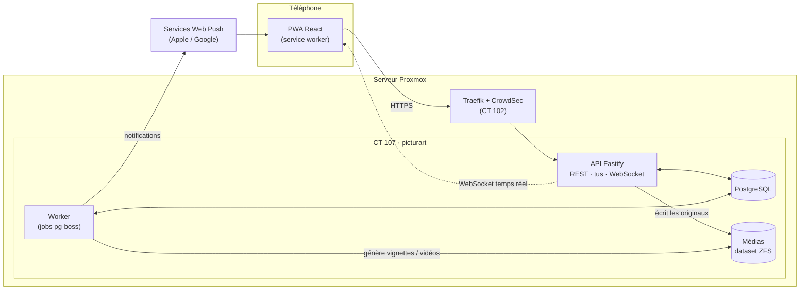
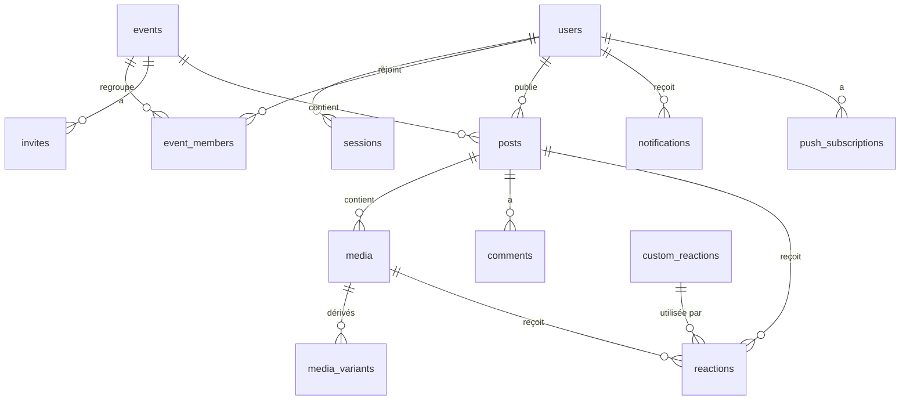
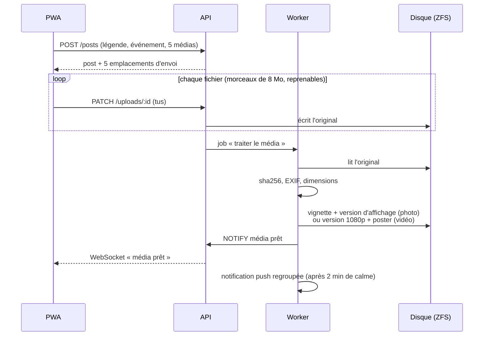

# Pictur'Art — Architecture technique

> Version 0.1 — 12 octobre 2026 — proposition à valider
> S'appuie sur le [cahier des charges](cahier-des-charges.md), la [direction artistique](direction-artistique.md) et les [maquettes v1](https://claude.ai/artifact/V3CSdGfjjonFEmnf31beMD).

---

## 1. Vue d'ensemble



- **Un seul serveur**, un seul conteneur LXC (CT 107) avec Docker Compose : API, worker, PostgreSQL.
- **L'API** gère l'authentification, les données, l'envoi des fichiers et le temps réel.
- **Le worker** fait le travail lourd en arrière-plan : vignettes, vidéos, notifications push, purge de la corbeille, souvenirs.
- Les deux partagent le même code (monorepo) et communiquent par la base (file de jobs + `LISTEN/NOTIFY`).

Ce découpage suffit largement pour une dizaine d'utilisateurs, tout en restant propre : rien n'empêche plus tard de séparer les services.

---

## 2. Stack

| Couche | Choix | Pourquoi |
|---|---|---|
| Langage | **TypeScript** partout | Un seul langage, types partagés front/back |
| Monorepo | **pnpm workspaces** | `apps/web`, `apps/api`, `packages/shared` |
| Front | **React 19 + Vite** | Continuité avec la v1, écosystème PWA mature |
| Routing front | **React Router 7** | Connu depuis la v1 |
| Données front | **TanStack Query** | Cache, pagination infinie du fil, mises à jour optimistes (réactions instantanées) |
| Styles | **CSS Modules + `design/tokens.css`** | Les tokens de la DA tels quels, sans framework |
| Icônes | **Lucide** | Style au trait de la DA |
| Polices | **@fontsource** (Rubik, Space Mono) | Auto-hébergées, pas d'appel à Google |
| PWA | **vite-plugin-pwa** (mode `injectManifest`) | Service worker sur mesure pour le push et le cache |
| Envoi de fichiers | **tus** (`tus-js-client` / `@tus/server`) | Envois reprenables, indispensables pour la 4K sur mobile |
| Back | **Fastify 5** | Rapide, typé, plugins officiels (cookies, rate-limit, websocket) |
| Validation | **Zod** (schémas dans `packages/shared`) | Mêmes règles côté client et serveur |
| Base | **PostgreSQL 17** | Relationnel, JSONB pour les notifications |
| ORM / migrations | **Drizzle ORM + drizzle-kit** | Requêtes SQL typées, migrations versionnées |
| Jobs | **pg-boss** | File de jobs dans PostgreSQL : pas de Redis à maintenir |
| Images | **sharp** (libvips) | Vignettes WebP rapides ; HEIC via libvips + libheif (voir §5) |
| Métadonnées | **exifr** | Date de prise de vue, orientation, GPS |
| Vidéos | **ffmpeg** + Intel QuickSync | Transcodage matériel sur l'iGPU de l'Optiplex |
| Mots de passe | **Argon2id** (`@node-rs/argon2`) | Recommandation OWASP |
| Push | **web-push** (VAPID) | Standard Web Push, sans service tiers |
| Tests | **Vitest** (unitaires + API), **Playwright** (bout en bout) | |
| CI | **GitHub Actions** | Lint, types, tests, build des images |
| Conteneurs | **Docker Compose**, images sur GHCR (privé) | |

---

## 3. Organisation du dépôt

```
picturart/
├── apps/
│   ├── web/                 # PWA React
│   │   ├── src/
│   │   │   ├── routes/      # écrans (fil, événement, visionneuse…)
│   │   │   ├── components/  # nav, carte post, planche contact, réactions…
│   │   │   ├── features/    # upload, temps réel, push
│   │   │   └── sw.ts        # service worker
│   │   └── public/
│   └── api/                 # Fastify + worker
│       ├── src/
│       │   ├── modules/     # auth, events, posts, media, reactions, comments…
│       │   ├── db/          # schéma Drizzle + migrations
│       │   ├── jobs/        # traitements pg-boss
│       │   ├── server.ts    # point d'entrée API
│       │   └── worker.ts    # point d'entrée worker
│       └── test/
├── packages/
│   └── shared/              # schémas Zod, types, constantes (rôles, emojis…)
├── design/tokens.css
├── docs/
├── infra/                   # docker-compose, Traefik, scripts de déploiement
└── .github/workflows/
```

---

## 4. Modèle de données



| Table | Colonnes principales | Notes |
|---|---|---|
| `users` | `id`, `display_name`, `email` (unique), `password_hash`, `avatar_media_id`, `bio`, `theme` (`auto`/`light`/`dark`), `notification_prefs` (JSONB), `created_at` | |
| `sessions` | `id`, `user_id`, `token_hash`, `expires_at`, `user_agent`, `last_seen_at` | Cookie opaque, seul son hash est stocké |
| `events` | `id`, `name`, `starts_on`, `ends_on`, `location`, `cover_media_id`, `posting_policy` (`all`/`admins`), `created_by`, `created_at`, `archived_at` | Les « albums » permanents |
| `event_members` | `event_id`, `user_id`, `role` (`admin`/`contributor`/`viewer`), `joined_at`, `last_seen_at` | `last_seen_at` → badges « 12 new » |
| `invites` | `id`, `event_id`, `token_hash`, `default_role`, `created_by`, `expires_at`, `revoked_at`, `use_count` | Lien `/i/<token>` |
| `posts` | `id`, `event_id`, `author_id`, `caption`, `created_at`, `updated_at`, `deleted_at` | `deleted_at` = corbeille 30 jours |
| `media` | `id`, `post_id`, `uploader_id`, `kind` (`photo`/`video`), `status` (`uploading`/`processing`/`ready`/`failed`), `position`, `original_path`, `mime`, `size_bytes`, `sha256`, `width`, `height`, `duration_ms`, `taken_at`, `deleted_at` | `taken_at` (EXIF) trie la planche contact |
| `media_variants` | `media_id`, `variant` (`thumb`/`display`/`video`/`poster`), `path`, `width`, `height`, `size_bytes` | |
| `reactions` | `id`, `user_id`, `post_id` *ou* `media_id`, `emoji` *ou* `custom_reaction_id`, `created_at` | Une réaction par personne et par cible |
| `custom_reactions` | `id`, `name`, `image_path`, `created_by`, `source_media_id`, `created_at` | « Tom choqué » |
| `comments` | `id`, `post_id`, `author_id`, `body`, `created_at`, `edited_at`, `deleted_at` | |
| `notifications` | `id`, `user_id`, `type`, `payload` (JSONB), `read_at`, `created_at` | Alimente l'écran Activité |
| `push_subscriptions` | `id`, `user_id`, `endpoint`, `p256dh`, `auth`, `created_at` | Un abonnement par appareil |

**Règles clés en base** : unicité `(user_id, post_id)` et `(user_id, media_id)` sur les réactions, clés étrangères en cascade sur les membres, index sur `(event_id, created_at)` pour le fil.

---

## 5. Pipeline des médias

C'est le cœur technique du projet : **originaux intacts, affichage rapide**.



### Photos
- **Original** stocké tel quel (JPEG, HEIC, PNG…), jamais modifié.
- **Vignette** 400 px et **affichage** 2048 px en WebP, rotation EXIF appliquée, **GPS retiré**.
- **HEIC** (iPhone) : les binaires standards de sharp ne lisent pas le HEIC. Piste retenue : sharp lié au **libvips système de Debian, compilé avec libheif + libde265**. À valider en premier (voir §10).

### Vidéos
- **Original** conservé (jusqu'à 4K60, HEVC, HDR).
- **Version de lecture** 1080p H.264 + **poster** JPEG, via ffmpeg avec **QuickSync** (`h264_qsv`).
- Vidéos iPhone **HDR** : conversion des couleurs vers SDR (tonemapping) pour éviter un rendu délavé. À valider sur de vrais fichiers.

### Stockage
```
/data/media/
├── originals/2026/10/<uuid>.<ext>
├── derived/<uuid>/thumb.webp | display.webp | video.mp4 | poster.jpg
└── uploads/            # morceaux tus en cours
```
- Dataset ZFS dédié `rpool/picturart`, monté dans le CT, avec **quota**.
- **Doublons** : `sha256` calculé à la réception ; un même fichier n'est stocké qu'une fois.

### Diffusion
- Route `GET /media/:id/:variant` : **vérifie que l'utilisateur est membre de l'événement**, puis envoie le fichier (avec gestion des plages HTTP pour la lecture vidéo).
- En-têtes `Cache-Control: private, max-age=31536000, immutable` : les fichiers ne changent jamais, le téléphone les garde en cache.

---

## 6. API

REST sous `/api/v1`, JSON, validée par Zod. Principales routes :

| Domaine | Routes |
|---|---|
| Auth | `POST /auth/login` · `POST /auth/logout` · `GET /me` · `PATCH /me` |
| Invitations | `GET /invites/:token` (aperçu public : événement, inviteur, nb de membres) · `POST /invites/:token/accept` (inscription ou ajout) · `POST /events/:id/invites` · `DELETE /invites/:id` |
| Événements | `GET /events` · `POST /events` · `GET /events/:id` · `PATCH /events/:id` · `DELETE /events/:id` |
| Membres | `GET /events/:id/members` · `PATCH /events/:id/members/:userId` (rôle) · `DELETE /events/:id/members/:userId` (retirer / quitter) |
| Fil & posts | `GET /feed?cursor=` · `GET /events/:id/posts?cursor=` · `GET /events/:id/media?sort=taken_at` (planche) · `POST /posts` · `PATCH /posts/:id` · `DELETE /posts/:id` |
| Envoi | `POST/PATCH/HEAD /uploads/*` (protocole tus) |
| Médias | `GET /media/:id/:variant` · `DELETE /media/:id` |
| Réactions | `PUT /posts/:id/reaction` · `DELETE /posts/:id/reaction` · idem sur `/media/:id/reaction` |
| Commentaires | `GET /posts/:id/comments` · `POST /posts/:id/comments` · `DELETE /comments/:id` |
| Réactions perso | `GET /custom-reactions` · `POST /custom-reactions` (recadrage d'un média) |
| Activité | `GET /notifications?cursor=` · `POST /notifications/read` |
| Push | `POST /push/subscriptions` · `DELETE /push/subscriptions/:id` |
| Temps réel | `GET /ws` (WebSocket) |

- **Pagination par curseur** (`created_at` + `id`), pas par numéro de page : le fil reste stable quand de nouveaux posts arrivent.
- **Droits** vérifiés dans un hook commun : appartenance à l'événement, puis rôle (table du cahier des charges §6).

### Temps réel
- Une connexion WebSocket par appareil ; le serveur l'abonne aux événements dont l'utilisateur est membre.
- Messages : `post.created`, `media.ready`, `reaction.updated`, `comment.created`, `notification.created`.
- Le front met à jour le cache TanStack Query à la réception : pas de rechargement.

### Notifications push
- Chaque action (photo postée, réaction, commentaire) crée une ligne `notifications`.
- Un job **regroupe** par destinataire et événement, avec 2 minutes de calme : « Léa a ajouté 17 photos » au lieu de 17 notifications.
- Préférences par utilisateur respectées (réglages de l'écran Mon profil).

---

## 7. Sécurité

- **Sessions** : cookie `HttpOnly`, `Secure`, `SameSite=Lax`, durée 90 jours glissante ; seul le hash du jeton est en base.
- **CSRF** : `SameSite=Lax` + vérification de l'en-tête `Origin` sur toutes les requêtes qui modifient.
- **Mots de passe** : Argon2id ; limitation de débit sur la connexion et l'acceptation d'invitation (`@fastify/rate-limit`) ; CrowdSec devant.
- **Invitations** : jeton aléatoire de 128 bits, expiration, révocation, compteur d'usage.
- **Médias** : jamais servis sans contrôle d'appartenance ; noms de fichiers aléatoires (UUID) ; type réel vérifié (pas seulement l'extension).
- **Secrets** : uniquement dans un `.env` sur le serveur, jamais dans Git ; scan de secrets dans la CI.
- **En-têtes** : CSP stricte, HSTS (déjà via Traefik), `X-Content-Type-Options`.

---

## 8. Infrastructure & déploiement

### Sur le serveur Proxmox
| Élément | Valeur proposée |
|---|---|
| Conteneur | **CT 107 `picturart`** (ancien emplacement d'Immich, supprimé), Debian 13, 4 cœurs, 4 Go RAM, IP `192.168.1.107` |
| Médias | Dataset ZFS **`rpool/picturart`**, quota **500 Go** |
| GPU | `/dev/dri/renderD128` partagé avec le CT (QuickSync) |
| Domaine | **`pictur.dylanbouillon.fr`** — route Traefik + CrowdSec, sur le modèle de `portfolio.yml` |
| Services | `docker compose` : `api`, `worker`, `postgres` |
| Sauvegardes | `pg_dump` quotidien dans le dataset + snapshots ZFS (sanoid) + sauvegarde Proxmox du CT ; **copie hors site toujours à mettre en place** |

### Chaîne CI/CD
1. **Pull request / push** → GitHub Actions : lint, vérification des types, tests (avec un PostgreSQL de test), build.
2. **Merge sur `main`** → construction des images Docker `api` et `web`, publication sur GHCR (privé).
3. **Déploiement** : un **runner GitHub auto-hébergé dans le CT 107** récupère les nouvelles images et relance `docker compose`. Il ne fait que des connexions sortantes : aucun port à ouvrir sur le serveur.
4. Migrations de base appliquées automatiquement au démarrage de l'API.

### Environnements
- **Local** : `docker compose` (PostgreSQL) + `pnpm dev` (API et front en rechargement à chaud).
- **Production** : CT 107.
- Pas de préproduction au début ; on l'ajoutera si besoin.

---

## 9. Feuille de route

| Jalon | Contenu | Résultat |
|---|---|---|
| ✅ **M0 · Fondations** | Monorepo, CI, Docker, CT 107, Traefik, déploiement automatique | Une page « Pictur'Art arrive » en ligne sur `pictur.dylanbouillon.fr` |
| ✅ **M1 · Comptes** | Invitations, inscription, connexion, profil, thème clair/sombre | La bande peut créer son compte |
| **M2 · Événements & photos** | Événements, membres, rôles, création de post, envoi tus, vignettes | On peut poster des photos |
| **M3 · Social** | Fil, page événement (planche), visionneuse, réactions, commentaires, temps réel | L'expérience de base est complète |
| **M4 · Vidéos & HEIC** | Transcodage QuickSync, HDR, HEIC | Les médias iPhone passent sans souci |
| **M5 · PWA & notifs** | Installation, push regroupées, écran Activité | On est prévenu quand la bande poste |
| **M6 · Fun** | Réactions perso, souvenirs « il y a 1 an », stats de profil | La personnalité de l'app |
| **Bêta** | Ouverture à la bande, retours, corrections | v1.0 |

---

## 10. Points à valider en priorité (« spikes »)

Ce sont les risques techniques ; mieux vaut les lever tôt, avant de construire dessus :

1. **HEIC** : sharp + libvips de Debian 13 décode-t-il les photos d'iPhone ? Sinon, plan B : conversion via `heif-convert` ou ffmpeg.
2. **Vidéo HDR iPhone + QuickSync** : rendu des couleurs après conversion, vitesse sur l'i5-8500T.
3. **Envoi depuis iOS Safari** : comportement de tus quand on verrouille le téléphone, reprise à la réouverture.
4. **Push sur iOS** : fonctionnement réel une fois la PWA installée sur l'écran d'accueil.
